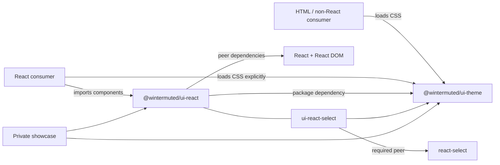
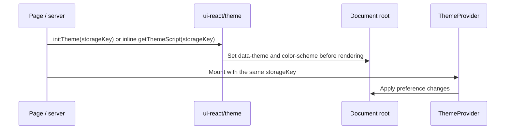

# Architecture

Wintermuted UI is an Nx monorepo with npm workspaces. It publishes a framework-independent CSS theme and an optional React integration, and uses a private, independently versioned Vite documentation package for both.

## Package boundaries



An installed dependency is not the same as a runtime import. `ui-react` declares its dependency on the theme, but does not inject the theme's global CSS. The application chooses when and how to load styles.

| Location | Owns | Does not own |
| --- | --- | --- |
| `packages/ui-theme` | Tokens, base styles, component CSS, stylesheet exports | React code, theme preference JavaScript, or React peers |
| `packages/ui-react/src` | Core React components, declarations, theme runtime helpers | react-select dependencies, a second CSS implementation, bundled React, or implicit global CSS loading |
| `packages/ui-react-select/src` | Typed MultiSelect adapter and declarations | Core component copies, bundled peers, or implicit global CSS loading |
| `packages/showcase` | Versioned static HTML documentation, internal shared site layouts, runnable React examples, documentation-specific presentation | A public npm package, external site framework, or an alternative component implementation |
| `scripts` | Staging, consumer linking, release baselines, and output checks | Hand-maintained copies of public component code |

The repository root is private. Consumers install a published workspace package, not the entire monorepo. See the [migration guide](migration-to-v1.md) for the removed 0.x exports.

For implementation detail, use the nested [theme architecture](../packages/ui-theme/docs/architecture.md) and [React architecture](../packages/ui-react/docs/architecture.md) guides. They cover each package's internal layers, extension rules, and validation boundaries without changing the dependency direction described here.

## CSS theme

The theme root is deliberately small:

```text
index.js
  -> index.css
       -> styles/tokens.css
       -> styles/base.css
       -> styles/components.css
            -> styles/components/*.css
```

`index.js` imports only CSS. It has no React imports or JavaScript initialization effects. CSS is plain source: there is no Sass compilation or generated component bundle.

The public contract consists of `--wm-*` custom properties, scoped component classes, and the stylesheet paths declared in `package.json`. Consumers can load the complete theme or selected stylesheets:

```js
import "@wintermuted/ui-theme";
```

```js
import "@wintermuted/ui-theme/styles/tokens.css";
import "@wintermuted/ui-theme/styles/base.css";
import "@wintermuted/ui-theme/styles/components/button.css";
```

When adding a component stylesheet, register it in both `styles/components.css` and the theme manifest's `exports`. Keep selectors scoped and derive values from shared tokens rather than introducing competing design constants.

Light/dark appearance is controlled by document theme attributes and CSS tokens. Applications that do not use React can select a theme themselves; no JavaScript helper is required to consume the CSS.

## React integration

React components are authored in TypeScript/TSX and published as JavaScript with generated `.d.ts` declarations:

| Entry point | Purpose | Runtime boundary |
| --- | --- | --- |
| `@wintermuted/ui-react` | Components, `ThemeProvider`, `useTheme`, `ThemeSelect` | Imports React; does not import react-select or inject CSS |
| `@wintermuted/ui-react-select` | `MultiSelect` adapter | Requires react-select as a peer; independent of ui-react |
| `@wintermuted/ui-react/theme` | `initTheme`, `getThemeScript`, preference helpers | Helper implementation has no React imports |

Primitives map native props and refs onto semantic elements and shared CSS classes. Stateful components own their interaction behavior, not application routing, data fetching, or grid layout. The [React README](../packages/ui-react/README.md) is the contract for accessibility, controlled state, keyboard behavior, and supported props.

Keep select integration isolated in `ui-react-select` so ordinary component consumers do not need react-select. The former `ui-react/select` export is removed. React and React DOM remain consumer-supplied peers; they must not be bundled into either React package.

### Theme initialization and SSR



For client rendering, initialize the theme before mounting React. For SSR first paint, emit the synchronous script in the head before styles and preserve the application's CSP nonce. Use the same storage key for initialization and the provider.

Preferences are System, Light, or Dark. Overrides persist in local storage; System follows OS changes. The runtime changes document theme attributes and color scheme, not application data or map layers. The default key is `wintermuted:theme`; applications can namespace it.

## Source and package artifacts

`packages/ui-react/src` is the canonical TypeScript/TSX implementation. Its Nx `build` target runs `scripts/stage-react.mjs`, compiling ESM and declarations and copying README, license, and a manifest without Nx metadata to `dist/packages/ui-react`.

Compilation generates declarations without bundling peers. `nx pack ui-react` and its release publish target use the staged directory with JavaScript/declaration export paths. Consumer tests pack that same compiled output; do not pack the TypeScript source workspace directly.

The same staging script accepts `ui-react-select` and compiles its standalone
source into `dist/packages/ui-react-select`, deriving compiled export paths from
each package manifest. Both source workspaces reject direct packing.

The theme publishes its source styles directly. Theme 1.0 no longer copies React files during `prepack`; generated legacy React copies must not become a second source of truth.

There is one root lockfile. Declare dependencies in the workspace that uses them; do not rely on incidental hoisting or create nested lockfiles.

## Nx graph and caching

The dependency directions are `showcase -> ui-react -> ui-theme` and `showcase -> ui-react-select -> ui-theme`, with an additional direct `showcase -> ui-theme` dependency. Storybook follows the same workspace dependencies. The theme does not depend on either React package, and the adapter does not depend on ui-react.

Nx infers workspace relationships from package manifests. Shared inputs include root manifests, the root lockfile, `nx.json`, and the React staging script. Build/typecheck inputs include upstream inputs; build targets depend on upstream build targets where present.

The graph supports cache invalidation, task ordering, and independent release dependency updates. It does not mean the CSS theme needs a compilation step or that every component consumer must use React.

## Showcase and deployment

The showcase uses both workspaces locally. Categorized HTML sources live under `packages/showcase/src/pages`, shared layouts and the Vite plugin under `src/templates`, CSS under `src/styles`, and the React example entry under `src/examples`. `src/site.config.mjs` is the single page/navigation registry: each page maps a nested `source` to a stable public `file`. Vite derives build inputs from that registry and recursively validates that every HTML source is registered, rather than maintaining a separate entry list.

| Surface | Location |
| --- | --- |
| Development | `http://localhost:4174/showcase/` |
| Built HTML | `dist/packages/showcase/showcase` |
| Production | `https://wintermuted.github.io/wintermuted-ui/showcase/` |
| PR preview | `/wintermuted-ui/previews/pr-<number>/showcase/` on the Pages host |

Development uses `/showcase/`; the site plugin maps flat public page requests to nested sources and preserves canonical hot-reload URLs. Production emits the same flat HTML filenames with relative asset URLs so the same output works under nested previews. Source asset URLs resolve from Vite's `src` root, not each page's category folder. The shared classic script is `packages/showcase/public/showcase.js`. Preserve its runtime assets, including the logo, as well as page-local scripts and styles.

The private package is release-managed by Nx, starting at `0.1.0`, with independent changelogs and `showcase@X.Y.Z` tags. Its own releasable changes and declared dependency updates trigger releases. Each GitHub release includes a static archive containing `.nojekyll` and the `showcase/` directory, not an npm package. External framework distribution is deferred; internal templates share document metadata, assets, header, sidebar, and shell while preserving plain HTML content and presentation.

`scripts/check-showcase.mjs` checks that all source HTML pages exist in the build and that referenced local assets resolve without root-relative URLs.

The private `packages/storybook` workspace complements the showcase with interactive React documentation. It builds to `dist/packages/storybook` and uses relative Vite assets, including under query-based story/Docs deep links. Production is served at `/wintermuted-ui/storybook/` and PR previews at `/wintermuted-ui/previews/pr-<number>/storybook/`. Storybook is excluded from Nx Release and npm publishing.

The documentation Pages workflow builds both sites and runs `scripts/stage-pages.mjs` to check Storybook entry-point assets and assemble one shared tree. Production replacement preserves `.git` and `previews/`; a PR replaces only `previews/pr-<number>/`, containing both `showcase/` and `storybook/`. Preview comments link to both sites only after Pages succeeds. The cleanup workflow deletes the closed PR's whole tree and republishes the remaining artifact so removal takes effect on the live site. It republishes even when that directory is already absent, making retries reconcile live Pages after a successful branch update but failed publication. Both workflows share the `pages` concurrency group with `queue: max` to retain up to 100 pending runs instead of replacing an earlier cleanup.

In the cleanup workflow, the branch-update job has only `contents: write`. Pages configuration and publication run in a separate job with only `pages: write` and `id-token: write`; the cleanup steps do not receive Pages/OIDC privileges.

Markdown architecture/release documentation stays in `docs` on GitHub; it is not an HTML build input.

## Validation responsibilities

| Check | Protects |
| --- | --- |
| `npm test` | Component behavior, CSS exports, local linking, release selection, and baseline cleanup |
| `npm run test:pack` | Real packed installation, no React in CSS-only consumers, and standalone React imports |
| `npm run test:browser` | Native browser interactions |
| CI consumer checks | TypeScript declarations, React 18 compatibility, Vite and Webpack integration |
| CI showcase output checks | All HTML pages and nested deployment asset paths |
| CI lint/typecheck/build | CSS quality, declaration correctness, and distributable application output |

Leave lint, typecheck, and builds to CI. For implementation work, run the smallest existing behavioral or packaging check that covers the change. Pure documentation changes do not require a local build.

## Contribution checklist

Choose the owning package before editing. Add CSS, registration, exports, and showcase examples together for styling changes. Add JavaScript, declarations, and focused behavior tests together for React API changes. Keep imports framework-independent on the theme side and isolate optional adapters.

Breaking public paths or contracts require a migration guide and a conventional-commit breaking marker. Package versions, release tags, and publication follow the [release runbook](releases.md).
