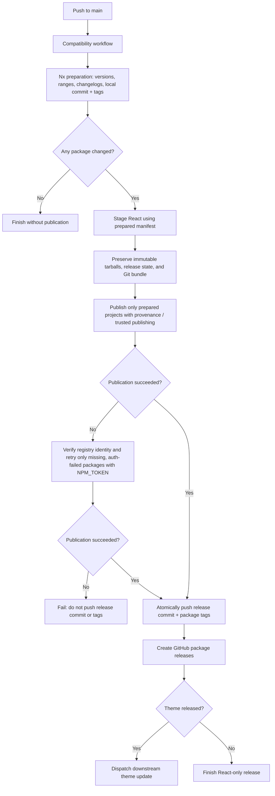

# Release runbook

Nx Release owns package versions, dependency-range updates, changelogs, and GitHub releases. The publication wrapper packs Nx-selected projects once and publishes those immutable tarballs with npm, so retries cannot rebuild different bytes or blindly retry a successful package. The checked-in workflow publishes `ui-theme` and `ui-react` independently after compatibility checks. It does not publish the private root or showcase.

This guide describes the 1.0 release configuration. A manifest version or successful Pages deployment is not evidence that a package has been published.

## Release identities and artifacts

| Package | Source manifest | Published content | Tag |
| --- | --- | --- | --- |
| `@wintermuted/ui-theme` | `packages/ui-theme/package.json` | CSS, the CSS-loading root, README, and license | `ui-theme@X.Y.Z` |
| `@wintermuted/ui-react` | `packages/ui-react/package.json` | Staged ESM, declarations, manifest, README, and license | `ui-react@X.Y.Z` |

Versions are independent: a React-only change need not bump the theme. When the theme changes, Nx may also update the dependent React package and its required theme range. `preserveMatchingDependencyRanges` is disabled so an out-of-range major dependency update can be written instead of blocking release preparation.

Legacy `vX.Y.Z` theme tags are retained. Do not rewrite them, move an existing package tag, or reuse an npm version for different content.

## Configuration map

| File | Responsibility |
| --- | --- |
| `nx.json` | Released projects, independent versions, tag format, conventional commits, dependency updates, changelogs |
| `packages/*/package.json` | Public exports, package files, dependencies, pack/publish targets |
| `scripts/release.mjs` | Dry run, preparation state, and GitHub release finalization |
| `scripts/release-changelog.mjs` | Finalize each changed project's notes from its own pre-release baseline |
| `scripts/release-baseline.mjs` | Temporary legacy and first-React baselines |
| `scripts/release-publication.mjs` | Immutable tarballs, exact registry verification, and per-package publication attempts |
| `scripts/release-recovery.mjs` | Validate tagged, preserved-artifact, or bounded legacy recovery sources |
| `scripts/stage-react.mjs` | Assemble the React package without bundling peers |
| `.github/workflows/react-package.yml` | Compatibility workflow reused as the release gate |
| `.github/workflows/auto-release.yml` | Publication, atomic Git push, finalization, and theme downstream dispatch |
| `.github/workflows/publish-package.yml` | Recover one selected package without changing versions or inventing tags |
| `.github/workflows/bump-downstream.yml` | Notify configured downstream theme consumers |

## Version selection

Use conventional commits and preserve the intended message when squashing a PR:

| Change | Example merge message | Expected selection |
| --- | --- | --- |
| Bug fix | `fix: correct dialog focus restoration` | Patch for affected released projects |
| New compatible feature | `feat: add a component variant` | Minor for affected released projects |
| Removed export or incompatible API | `feat!: separate CSS theme from React integration` | Major for affected released projects |
| Non-releasable maintenance | `chore: update repository tooling` | No bump unless other releasable changes exist |

A `BREAKING CHANGE:` footer is another way to express a breaking release. A message alone does not select every package: Nx combines commit history with affected project files and dependency relationships. Review the dry-run output rather than assuming a version from the PR title.

Zero-major adjustment is disabled. A major selection from theme 0.22.0 becomes 1.0.0, not another 0.x minor.

### The initial 1.0 split

Both source manifests were set to 1.0.0 through Nx Release's explicit version command, without creating release tags or publishing locally. Preserve an unscoped breaking merge message for the split so automated preparation selects 1.0.0 from the previous theme and initial React baselines.

Before the first standalone React release, the wrapper finds the commit that introduced `packages/ui-react/package.json` and temporarily tags that commit with its original version. It does not use the newly bumped manifest as the historical baseline. Once a real reachable `ui-react@...` release exists, that tag becomes the baseline.

For theme history without an Nx tag, the wrapper temporarily maps the latest reachable legacy `v...` tag to the equivalent `ui-theme@...` tag. Temporary tags are removed after success or failure. Missing history fails explicitly rather than silently treating the theme as a new package.

## Before merging

Confirm the public package boundary, update directly related documentation, and include migration instructions for breaks. For this split, external React consumers must migrate all removed subpaths, not merely upgrade the CSS dependency.

Check the CI results, including the separate CSS lint workflow. Auto Release directly waits for the reusable React/package compatibility job; it does not depend on the separate lint or Pages jobs. Branch protection should enforce the required checks before merge.

Preview version selection without publication:

```sh
npm run release -- --dry-run
```

Use a checkout with full reachable release history. Uncommitted edits are not conventional-commit history; preview a committed candidate when checking its release selection. The dry run does not change manifests or publish, and cleans up temporary baseline tags.

Lint, typecheck, and builds remain CI responsibilities. The runbook commands below describe workflow operations, not a requirement to run them locally before every commit.

## Automated release sequence



Auto Release runs on pushes to `main` and serializes releases through its concurrency group. The release job uses the GitHub environment `wintermuted-ui-theme` for both packages.

The wrapper has three modes:

| Mode | Effect |
| --- | --- |
| `--dry-run` or no flag | Preview versions/changelogs; skip publication and persistent version writes |
| `--prepare` | Require a clean checkout, run Nx version/changelog preparation, create local commit/tags, save state |
| `--finalize` | Require saved state matching HEAD; create GitHub releases without re-versioning or pushing |

Preparation writes `.nx/release-state.json` with each project's pre-release baseline commit, project version data, and prepared commit. Workflow outputs distinguish any release (`released`) from a theme release (`theme_released`), and include the changed project names and package tags to push. Only those projects are packed into `.nx/prepared-release/publication.json`; the workflow preserves their tarballs, SHA-512 integrity, release state, and full Git bundle in the `prepared-release` artifact before the first npm write (90-day retention).

Both publication attempts read the same tarballs. An already-published package is skipped only when the public registry matches its exact name, version, and tarball integrity. Explicit npm-registry 404 absence permits initial publication; HTTP/auth/network errors, malformed responses, and content mismatches fail rather than becoming absence. The `publication-attempts` artifact records accepted, verified, auth-failed, or unresolved writes without credentials. An accepted-but-not-visible or unknown-network outcome cannot be retried automatically. Only an explicit authentication failure with verified registry absence is eligible for token fallback. A React-only release never publishes the unchanged theme.

Finalization generates notes separately for each changed project, from its saved baseline to the prepared commit. The React baseline advances independently of the theme, preventing earlier React-only changes from appearing again in later releases. Finalization depends on that state; a fresh tagged checkout alone cannot reconstruct it.

React is staged **after** version preparation so `dist/packages/ui-react/package.json` contains the released version and current dependency ranges, not stale compatibility-build metadata.

The release commit and all selected package tags are pushed together with `git push --atomic`. This protects Git references only. npm publication is a separate external operation and is not transactional across packages.

## Publication prerequisites

Both packages publish publicly to npm. The release runner installs npm 11.5.1, enables provenance, and grants `id-token: write` for trusted publishing.

Configure npm trusted publishing separately for each package, using repository `wintermuted/wintermuted-ui`, workflow filename `auto-release.yml`, and environment `wintermuted-ui-theme`. The new React package needs its own configuration; the theme's configuration does not authorize it automatically. If the initial package cannot yet use trusted publishing, provide an authorized `NPM_TOKEN` fallback for the first publication.

Keep `NPM_TOKEN` and `DOWNSTREAM_PAT` in GitHub secrets with the required package/repository permissions. The npm secret must be named **NPM_TOKEN**, not `NPM`, in `wintermuted-ui-theme`. Never retrieve or print its value. Do not put credentials in manifests, logs, examples, or release state. GitHub's workflow token supplies Git pushes and GitHub release creation; npm authorization is separate.

For terminal GitHub operations on wintermuted-owned repositories, use wintermuted's authorized credentials. Copilot account selection is separate from repository publication identity.

## First stable release checklist

Before announcing 1.0:

1. Verify the split's breaking merge message and dry-run selections for both packages.
2. Confirm npm publication access for both package names, especially the new React package.
3. Let Auto Release publish both packages and push their release commit/tags.
4. Confirm the registry versions, package dependency ranges, and successful GitHub releases.
5. Migrate Overworld using the [1.0 guide](migration-to-v1.md); keep other React consumers on 0.x until both packages are available.

Registry verification is read-only:

```sh
npm view @wintermuted/ui-theme@1.0.0 version
npm view @wintermuted/ui-react@1.0.0 version dependencies peerDependencies
```

The automatic downstream matrix currently includes `wintermuted/cv` and `wintermuted/sub-killer`, not Overworld or every discovered theme consumer. Their repository dispatch handlers control what happens next; a successful dispatch is not a completed consumer migration.

## Recovery

Identify the failed stage and inspect npm and GitHub before retrying. Never infer that nothing published merely because the overall job failed.

| Failure | What may already exist | Response |
| --- | --- | --- |
| Compatibility or preparation | No publication from this run | Fix the reported source/configuration problem and rerun CI. |
| Trusted npm attempt | Some package versions may exist | Inspect the fallback result and registry before further action. |
| Both npm attempts | One package may have published; Git refs have not been pushed by this run | Correct permissions/content problems, then recover the failed release run. Do not reuse a published version with different content. |
| Atomic Git push | npm packages may exist; release Git refs were not updated by that push | Resolve remote advancement/access issues and verify the exact published content before retrying. Do not force-push main. |
| GitHub finalization | npm packages and Git tags exist | Recover GitHub release creation using the prepared state from the same release context or deliberate maintainer recovery; do not republish just to create a release page. |
| Downstream dispatch | Packages, tags, and GitHub releases exist | Retry the dispatch for the existing theme version; do not create another package release. |

If main advanced after a failed run, do not blindly rerun an older preparation and publish different content under an existing npm version. Compare the release logs, manifests, tags, and registry first. A published npm version is immutable.

### Existing-tag publication recovery

The manual **Publish package (recovery)** workflow accepts exactly one source: an existing matching package tag, a `prepared_run` with preserved artifacts, or the narrowly bounded legacy `source_run` described below. It defaults to React and a dry run. Tag recovery checks out the tag, verifies the manifest version, and stages React when selected; artifact recovery publishes the original tarball without rebuilding. Both verify exact registry identity/integrity and publish only the selected missing package. Neither bumps versions.

Preview a tagged React publication:

```sh
gh workflow run publish-package.yml --repo wintermuted/wintermuted-ui -f release_tag=ui-react@1.0.0 -f project=ui-react -f dry_run=true
```

After inspecting the preview, a maintainer can deliberately invoke it with `dry_run=false`. A theme recovery uses `project=ui-theme` and a matching theme tag.

Recovery uses the **token** path with provenance. Its OIDC workflow identity is `publish-package.yml`, not `auto-release.yml`: an Auto Release trusted publisher binding does not authorize this workflow. Bootstrap React with an npm token authorized to create the public scoped package, then configure React's own Auto Release trusted publisher.

### Interrupted-release artifacts and missing tags

For a failed Auto Release run that preserved `prepared-release` and `publication-attempts`, preview one exact package without re-running version preparation:

```sh
gh workflow run publish-package.yml --repo wintermuted/wintermuted-ui -f prepared_run=RUN_ID -f project=ui-react -f version=1.0.0 -f dry_run=true
```

Use `dry_run=false` only after reviewing the preview and authorization. Missing artifacts or unresolved prior attempts fail explicitly; do not discard attempt evidence to bypass uncertainty. The recovery run also preserves `recovery-packages` and `recovery-publication-attempts`.

The original interrupted 1.0 run `45091280105` predates these artifacts. Its source was inspected at commit `b051c09020072f2224d38a31bc89c9c42a3d6155`, with both manifests already at 1.0.0 and successful compatibility checks. The legacy exception permits **only ui-react@1.0.0** from that exact failed Auto Release run, preserving a newly packed React tarball before any write:

```sh
gh workflow run publish-package.yml --repo wintermuted/wintermuted-ui --ref FEATURE_BRANCH -f source_run=45091280105 -f project=ui-react -f version=1.0.0 -f dry_run=true
```

It does not republish theme, reconstruct the lost original release commit, or claim that the newly packed artifact is the lost original tarball. No missing tags or release commits are fabricated. The existing workflow can be dispatched from an authorized feature ref; environment branch protection may require landing changes first.

Publication recovery does not push Git references, create missing GitHub releases, or dispatch downstream updates. For future runs, the preserved Git bundle contains the exact prepared commit/tags and the saved state needed for finalization. A maintainer must validate the bundle/state and current remote ancestry before completing Git finalization; do not force-push main if it advanced. The legacy 1.0 run has no such bundle/state, so missing 1.0 tags and release finalization remain a separate maintainer decision even after React publication succeeds.

### Downstream dispatch recovery

For an already-published theme release:

```sh
gh workflow run bump-downstream.yml --repo wintermuted/wintermuted-ui -f version=1.0.0 -f release_tag=ui-theme@1.0.0
```

Do not dispatch a theme bump for a React-only release. Auto Release explicitly calls this workflow because GitHub releases created with the workflow token do not trigger another release-event workflow.

## What release automation does not do

It does not migrate consumer imports, guarantee publication is atomic across npm packages, validate external applications, or turn Pages deployment into an npm release. A dependency bump in a consumer is not sufficient for a breaking API migration.

For Overworld, upgrade imports and manifests together only after both packages are available. For release rollback, restore consumer versions and code together; do not move tags or attempt to overwrite an npm version.
