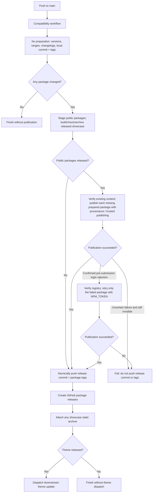

# Release runbook

Nx Release owns package versions, dependency-range updates, changelogs, npm publication, and GitHub releases. The checked-in workflow releases `ui-theme`, `ui-react`, and `showcase` independently after compatibility checks. It publishes only the public theme and React packages to npm; the private root and showcase are never published to npm.

This guide describes the 1.0 release configuration. A manifest version or successful Pages deployment is not evidence that a package has been published.

## Release identities and artifacts

| Package | Source manifest | Published content | Tag |
| --- | --- | --- | --- |
| `@wintermuted/ui-theme` | `packages/ui-theme/package.json` | CSS, the CSS-loading root, README, and license | `ui-theme@X.Y.Z` |
| `@wintermuted/ui-react` | `packages/ui-react/package.json` | Staged ESM, declarations, manifest, README, and license | `ui-react@X.Y.Z` |
| `@wintermuted/showcase` (private) | `packages/showcase/package.json` | GitHub release archive `showcase-X.Y.Z.tar.gz` containing `.nojekyll` and the static `showcase/` site | `showcase@X.Y.Z` |

Versions are independent: a React-only change need not bump the theme. When the theme changes, Nx may also update the dependent React package and its required theme range. `preserveMatchingDependencyRanges` is disabled so an out-of-range major dependency update can be written instead of blocking release preparation.

Showcase versions advance for direct releasable changes and declared theme/React dependency updates. Its initial release is explicitly `0.1.0`, independent of the introducing commit's conventional type. No artificial historical showcase release tag is created. Subsequent releases use the latest reachable showcase tag as their baseline.

Legacy `vX.Y.Z` theme tags are retained. Do not rewrite them, move an existing package tag, or reuse an npm version for different content.

## Configuration map

| File | Responsibility |
| --- | --- |
| `nx.json` | Released projects, independent versions, tag format, conventional commits, dependency updates, changelogs |
| `packages/*/package.json` | Public exports, package files, dependencies, pack/publish targets |
| `scripts/release.mjs` | Dry run, preparation state, and GitHub release finalization |
| `scripts/release-publication.mjs` | Per-package authentication fallback and exact downloadable-content verification |
| `scripts/release-reconcile.mjs` | Merge newer main without moving prepared tags, then push Git refs atomically |
| `scripts/release-changelog.mjs` | Finalize each changed project's notes from its own pre-release baseline |
| `scripts/release-baseline.mjs` | Temporary legacy/first-React baselines and initial showcase release detection |
| `scripts/stage-react.mjs` | Assemble the React package without bundling peers |
| `.github/workflows/react-package.yml` | Compatibility workflow reused as the release gate |
| `.github/workflows/auto-release.yml` | Publication, atomic Git push, finalization, and theme downstream dispatch |
| `.github/workflows/publish-package.yml` | Republish an existing tagged package without changing versions |
| `.github/workflows/bump-downstream.yml` | Notify configured downstream theme consumers |

## Version selection

Use conventional commits and preserve the intended message when squashing a PR:

| Change | Example merge message | Expected selection |
| --- | --- | --- |
| Bug fix | `fix: correct dialog focus restoration` | Patch for affected released projects |
| New compatible feature | `feat: add a component variant` | Minor for affected released projects |
| Removed export or incompatible API | `feat!: separate CSS theme from React integration` | Major for affected released projects |
| Non-releasable maintenance | `chore: update repository tooling` | No bump unless other releasable changes exist |

A `BREAKING CHANGE:` footer is another way to express a breaking release. A message alone does not select every package: Nx combines commit history with affected project files and dependency relationships. Review the dry-run output rather than assuming a version from the PR title.

To release previously merged non-releasable work (such as a `refactor:`), follow it with an unscoped `fix:` commit updating release documentation inside each intended package. Package-local README changes count as affected files. For the typed TSX migration, preserve `fix: release all packages after typed TSX migration` as the merge message: the theme, React package, and showcase each receive a patch selection. Leave manifests and changelogs unchanged until Auto Release prepares them with Nx; showcase receives a GitHub archive, not an npm publication.

Zero-major adjustment is disabled. A major selection from theme 0.22.0 becomes 1.0.0, not another 0.x minor.

### The initial 1.0 split

Both source manifests were set to 1.0.0 through Nx Release's explicit version command, without creating release tags or publishing locally. Preserve an unscoped breaking merge message for the split so automated preparation selects 1.0.0 from the previous theme and initial React baselines.

Before the first standalone React release, the wrapper finds the commit that introduced `packages/ui-react/package.json` and temporarily tags that commit with its original version. It does not use the newly bumped manifest as the historical baseline. Once a real reachable `ui-react@...` release exists, that tag becomes the baseline.

For theme history without an Nx tag, the wrapper temporarily maps the latest reachable legacy `v...` tag to the equivalent `ui-theme@...` tag. Temporary tags are removed after success or failure. Missing history fails explicitly rather than silently treating the theme as a new package.

## Before merging

Confirm the public package boundary, update directly related documentation, and include migration instructions for breaks. For this split, external React consumers must migrate all removed subpaths, not merely upgrade the CSS dependency.

Check the CI results, including the separate CSS lint workflow. Auto Release directly waits for the reusable React/package compatibility job; it does not depend on the separate lint or Pages jobs. Branch protection should enforce the required checks before merge.

Preview version selection without publication:

```sh
npm run release -- --dry-run
```

Use a checkout with full reachable release history. Uncommitted edits are not conventional-commit history; preview a committed candidate when checking its release selection. The dry run does not change manifests or publish, and cleans up temporary baseline tags.

Lint, typecheck, and builds remain CI responsibilities. The runbook commands below describe workflow operations, not a requirement to run them locally before every commit.

## Automated release sequence



Auto Release runs on pushes to `main` and serializes releases through its concurrency group. After the compatibility gate, it fetches current `main` rather than preparing an obsolete queued event checkout. The release job uses the GitHub environment `wintermuted-ui-theme` for both packages.

The wrapper has three modes:

| Mode | Effect |
| --- | --- |
| `--dry-run` or no flag | Preview versions/changelogs; skip publication and persistent version writes |
| `--prepare` | Require a clean checkout, run Nx version/changelog preparation, create local commit/tags, save state |
| `--finalize` | Require saved state matching HEAD; create GitHub releases without re-versioning or pushing |

Preparation writes `.nx/release-state.json` with each project's pre-release baseline commit, project version data, and prepared commit. Workflow outputs distinguish any release (`released`), a theme release (`theme_released`), and a showcase release (`showcase_released`). `projects` contains only changed npm-publishable project names; `tags` contains all release tags, including showcase. Publication is skipped when the public project filter is empty. Showcase outputs also include its version and tag.

Publication processes public projects individually. Before publishing, it checks the exact registry version and downloads its tarball, verifies SHA-1 and SHA-512, and compares the published checksum with the prepared package's `npm pack --dry-run --ignore-scripts` checksum. Identical existing content is skipped; different content or registry/transport errors fail closed. A trusted failure is checked again read-only. Token fallback is allowed only for npm's confirmed pre-submission `ENEEDAUTH` login rejection, identified from the captured summary/detail that Nx preserves; it targets only that package and uses a temporary credential configuration. A 404 after an uncertain failed command is not proof of rejection: staged/delayed visibility stops recovery without resubmission. Other failures, including generic HTTP authentication errors, are not classified as safe fallback. After a successful publication command, an explicit metadata 404 triggers read-only checks every 15 seconds for up to 10 minutes of waiting; this never retries publication. Registry/transport errors, tarball failures, and content mismatches still fail immediately. After submission, the package must be downloadable and match before Git references or releases advance. Exhausting the visibility window stops finalization and requires read-only investigation, not automatic resubmission.

Finalization generates notes separately for each changed project, from its saved baseline to the prepared commit. The React baseline advances independently of the theme, preventing earlier React-only changes from appearing again in later releases. Finalization depends on that state; a fresh tagged checkout alone cannot reconstruct it.

React is staged **after** version preparation so `dist/packages/ui-react/package.json` contains the released version and current dependency ranges, not stale compatibility-build metadata.

When showcase releases, CI builds it after version preparation, checks all built pages and relative assets, and creates `dist/showcase-X.Y.Z.tar.gz` from `dist/packages/showcase`. It extracts the archive into a fresh temporary directory and compares its complete contents with the built site before publication. The archive retains the `showcase/` directory for existing URLs. After finalization, `gh release upload --clobber` attaches it to the corresponding showcase release. Build/check/archive/upload errors fail the workflow. Showcase-only releases do not invoke npm publication or need npm publishing credentials.

Before any npm submission, CI uploads a `prepared-release-RUN_ID` artifact containing the original commit/history and tags in `.nx/prepared-release.bundle`, `.nx/release-state.json`, the staged React package, and any showcase archive. The artifact includes hidden files and is retained for 90 days. Artifact upload failure blocks publication.

The release commit and all selected package tags are pushed together with `git push --atomic`. If main advanced, reconciliation merges it into the prepared commit without rebasing or moving the package tags. Thus new features remain on main but are not mislabeled as part of the already-published package tree. Conflicts stop explicitly; no force push or automatic conflict resolution is used. A push is retried (at most five attempts) only when a fresh fetch proves concurrent forward advancement of main. Other failures stop for recovery. Finalization switches back to the original prepared commit, so saved baselines, release notes, and the showcase archive retain the original release boundary. This protects Git references only. npm publication is a separate external operation and is not transactional across packages.

## Publication prerequisites

Both packages publish publicly to npm. The release runner installs npm 11.5.1, enables provenance, and grants `id-token: write` for trusted publishing.

Configure npm trusted publishing separately for each package, using the repository and Auto Release workflow identity and matching environment where required. The new React package needs its own configuration; the theme's configuration does not authorize it automatically. If the initial package cannot yet use trusted publishing, provide an authorized `NPM_TOKEN` fallback for the first publication.

Keep `NPM_TOKEN` and `DOWNSTREAM_PAT` in GitHub secrets with the required package/repository permissions. Do not put credentials in manifests, logs, examples, or release state. GitHub's workflow token supplies Git pushes and GitHub release creation; npm authorization is separate.

For terminal GitHub operations on wintermuted-owned repositories, use wintermuted's authorized credentials. Copilot account selection is separate from repository publication identity.

## First stable release checklist

Before announcing 1.0:

1. Verify the split's breaking merge message and dry-run selections for both packages.
2. Confirm npm publication access for both package names, especially the new React package.
3. Let Auto Release publish both packages and push their release commit/tags.
4. Confirm the registry versions, package dependency ranges, and successful GitHub releases.
5. Migrate Overworld using the [1.0 guide](migration-to-v1.md); keep other React consumers on 0.x until both packages are available.

Registry verification is read-only:

```sh
npm view @wintermuted/ui-theme@1.0.0 version
npm view @wintermuted/ui-react@1.0.0 version dependencies peerDependencies
```

The automatic downstream matrix currently includes `wintermuted/cv` and `wintermuted/sub-killer`, not Overworld or every discovered theme consumer. Their repository dispatch handlers control what happens next; a successful dispatch is not a completed consumer migration.

## Recovery

Identify the failed stage and inspect npm and GitHub before retrying. Never infer that nothing published merely because the overall job failed.

| Failure | What may already exist | Response |
| --- | --- | --- |
| Compatibility or preparation | No publication from this run | Fix the reported source/configuration problem and rerun CI. |
| Trusted npm attempt | Some package versions may exist | Inspect the fallback result and registry before further action. |
| Both npm attempts | One package may have published; Git refs have not been pushed by this run | Correct permissions/content problems, then recover the failed release run. Do not reuse a published version with different content. |
| Atomic Git push | npm packages may exist; release Git refs were not updated by that push | Resolve remote advancement/access issues and verify the exact published content before retrying. Do not force-push main. |
| GitHub finalization | npm packages and Git tags exist | Recover GitHub release creation using the prepared state from the same release context or deliberate maintainer recovery; do not republish just to create a release page. |
| Showcase archive upload | Git tags and GitHub releases exist; the static asset may be absent | Recover the exact tagged site's checked static archive and upload it to the matching showcase release. Do not bump versions or republish npm packages. |
| Downstream dispatch | Packages, tags, and GitHub releases exist | Retry the dispatch for the existing theme version; do not create another package release. |

If main advanced after a failed run, do not blindly rerun an older preparation and publish different content under an existing npm version. Compare the release logs, manifests, tags, and registry first. A published npm version is immutable.

### Published packages with missing Git refs

Prefer the saved prepared artifact: restore its bundle and state, verify the staged packages against the canonical registry, and reconcile from the saved commit. Do not prepare from newer main to recover an older publication.

For older failed runs without a saved artifact, Auto Release also supports a deliberate `workflow_dispatch` with `recovery_source` set to the full original **source** SHA. This reconstructs Nx preparation from that source, builds in CI, saves a recovery artifact, and runs strict `--verify-only` content verification for every selected public package. Missing packages, checksum differences, or transport errors block all Git reconciliation; this path never calls either npm uploader. It then reconciles Git refs, finalizes from the original prepared tree, and attaches the original-source showcase archive. It does not notify downstream consumers or release newer main changes. If reconstruction differs (for example changelog dates or toolchain output), stop and investigate rather than changing published content or bypassing verification.

```sh
gh workflow run auto-release.yml --repo wintermuted/wintermuted-ui --ref REVIEWED_RECOVERY_BRANCH -f recovery_source=FULL_ORIGINAL_SOURCE_SHA
```

The workflow definition containing this recovery mode must be available on the selected ref. Review and verify that definition before execution; dispatch can update main/tags and create GitHub releases, but cannot upload missing npm packages. Newer unreleased source remains for a subsequent ordinary release.

### Complementary publication successes and staged conflicts

Run `45313138618` prepared `1.0.1` from source commit `a8308b4e69c0f40b494baae1f0464004547f4b4e`. Its trusted attempt accepted theme `1.0.1` (SHA-1 `8c2bbaea765c35abaa76c2406972f1a431b23594`) but React required login. The blanket token retry accepted React `1.0.1` (SHA-1 `f403e5810f1825f843da249f0f04e251b6116467`) and failed on the previously accepted theme with `409 Cannot publish over previously staged version`. The failed aggregate status therefore does not mean either submission failed, and “staged” alone does not establish public availability or a required npm approval.

Use the recovery workflow's read-only `verify_only=true` mode to inspect an exact registry version even when its Git tag was never pushed:

```sh
gh workflow run publish-package.yml --repo wintermuted/wintermuted-ui -f release_tag=ui-theme@1.0.1 -f verify_only=true
gh workflow run publish-package.yml --repo wintermuted/wintermuted-ui -f release_tag=ui-react@1.0.1 -f verify_only=true
```

This mode downloads and verifies the tarball and reports exact dependency ranges and checksums; it does not publish, create tags, or finalize releases. Compare its checksums with the failed run before recovering missing Git references. Local npm transport failures are not proof of absent versions. If npm has accepted a version but it remains unavailable, a package maintainer must inspect npm's package settings/status and any actual approval request, or contact npm support. Do not delete/unpublish versions, bypass approval gates, or bump versions to conceal the conflict. React trusted publishing still requires its own authorized configuration; token fallback does not repair that configuration.

On November 23, 2026, read-only verification runs [45315774312](https://github.com/wintermuted/wintermuted-ui/actions/runs/45315774312) (theme) and [45315777648](https://github.com/wintermuted/wintermuted-ui/actions/runs/45315777648) (React) downloaded both `1.0.1` tarballs and verified their SHA-1/SHA-512 digests. Both SHA-1 values matched the original publication logs; React required theme `^1.0.1`. No new publication or npm approval was needed. The failed run had not pushed `ui-theme@1.0.1`, `ui-react@1.0.1`, or `showcase@0.2.1`, so registry recovery and Git/GitHub release reconciliation remain distinct.

### Delayed visibility after the component transfer

Auto Release [45551981808](https://github.com/wintermuted/wintermuted-ui/actions/runs/45551981808) prepared theme `1.0.3`, React `1.2.0`, and showcase `0.2.3` from source commit `d12d5c6da5643d2d6aedce6da79ddaa6a3dc93da`. Theme publication reported success at 05:15:59 UTC on November 25, 2026, but the immediate exact-version lookup returned 404. Read-only verification [45552452550](https://github.com/wintermuted/wintermuted-ui/actions/runs/45552452550) still returned 404 at 05:16:59. A later read-only run [45553131827](https://github.com/wintermuted/wintermuted-ui/actions/runs/45553131827) downloaded the package at 05:22:41 with SHA-1 `931a54133332d43ca90d6e6d5962ac2ee1589f1c`, matching the original upload. No upload retry was needed. This confirms delayed public visibility, not a dry-run upload; the registry's internal reason for the delay is unknown.

The locked Nx 24.0.6 publisher constructs its success message from npm's successful JSON output and Nx's own dry-run flag, and suppresses successful npm stderr. It does not independently verify availability. No Nx cache hit or configured dry-run was present in the failed publication log. The separate `npm pack --dry-run` checksum command runs in a child process and does not change the parent's environment. An inherited npm dry-run setting could theoretically mislead Nx, but it does not explain this now-downloadable matching upload.

Recovery must treat theme `1.0.3` as already published and immutable. React publication was not reached, and the release commit, tags, GitHub releases, and showcase archive were not pushed/uploaded. The failed run retained no prepared-state/package archive artifact. Before authorizing recovery:

1. Reconstruct the original prepared release in an isolated checkout of the exact source revision with the original lockfile/toolchain and release baselines. Do not prepare from newer `main` and assume the same versions contain the same content.
2. Verify theme `1.0.3` read-only again and compare the reconstructed theme package checksum with `931a54133332d43ca90d6e6d5962ac2ee1589f1c`. Stop on any mismatch. Do not republish or overwrite it.
3. Inspect React `1.2.0` read-only before any authorized publication. Rebuild only the original prepared React content, verify its version and theme dependency range, and skip it only if existing registry content matches exactly. A 404 alone does not authorize a new upload.
4. With maintainer approval, publish only a confirmed missing React package, verify its downloadable content, then reconcile the prepared release commit/tags against current `main` without force-pushing or losing newer changes. Finalize project releases and attach the matching checked showcase archive from that same recovered state. Do not use the existing-tag recovery workflow for tags that were never pushed.

### Existing-tag publication recovery

The manual **Publish package (recovery)** workflow accepts an existing matching package tag and a package selection. It checks out that tag, verifies the manifest version, stages React when selected, and publishes only that project through Nx. It defaults to a dry run and never bumps versions.

Preview a tagged React publication:

```sh
gh workflow run publish-package.yml --repo wintermuted/wintermuted-ui -f release_tag=ui-react@1.0.0 -f project=ui-react -f dry_run=true
```

After inspecting the preview, a maintainer can deliberately invoke it with `dry_run=false`. A theme recovery uses `project=ui-theme` and a matching theme tag.

This workflow cannot recover a tag that was never pushed, create missing GitHub releases, or dispatch downstream updates. Those are different failure stages. It uses the npm token path with provenance, so verify that the recovery environment has valid publication authorization.

### Downstream dispatch recovery

For an already-published theme release:

```sh
gh workflow run bump-downstream.yml --repo wintermuted/wintermuted-ui -f version=1.0.0 -f release_tag=ui-theme@1.0.0
```

Do not dispatch a theme bump for a React-only release. Auto Release explicitly calls this workflow because GitHub releases created with the workflow token do not trigger another release-event workflow.

## What release automation does not do

It does not migrate consumer imports, guarantee publication is atomic across npm packages, validate external applications, or turn Pages deployment into an npm release. A dependency bump in a consumer is not sufficient for a breaking API migration.

For Overworld, upgrade imports and manifests together only after both packages are available. For release rollback, restore consumer versions and code together; do not move tags or attempt to overwrite an npm version.
