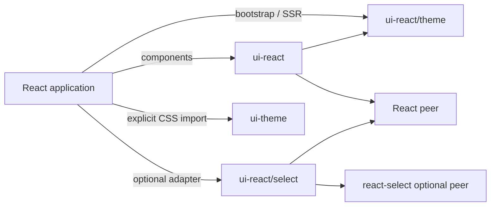
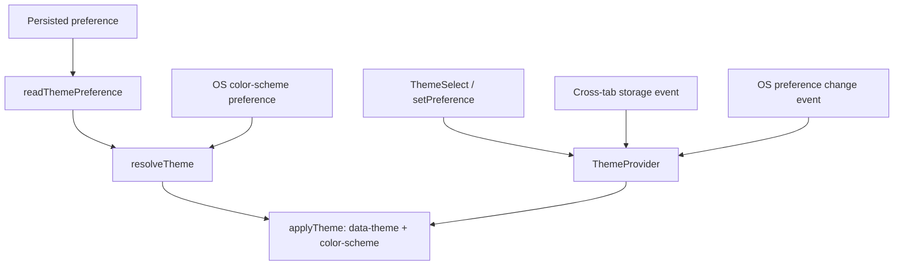

# React package architecture

`@wintermuted/ui-react` adds React behavior to the shared CSS theme: native primitives, accessible interactions, an optional select adapter, and theme preference helpers. It depends on `ui-theme`; the theme does not depend on it.

For public props and usage, see the [package README](../README.md). For broader relationships and publication, see the [monorepo architecture](../../../docs/architecture.md) and [release runbook](../../../docs/releases.md).

## Source and entry-point boundaries

```text
ui-react/
  src/
    index.tsx                Public component/type export barrel
    components/*.tsx         One file per component
    interfaces.ts            Shared native props, item types, and context contracts
    primitive.ts / utils.ts  Shared polymorphic factory, classes, and client effect
    ThemeContext.ts          Shared React theme context
    useTheme.ts              Theme context hook
    select.tsx               Typed optional react-select integration
    theme.ts                 React-free runtime theme helpers and types
  package.json               Exports, peers, theme dependency, Nx targets
  tsconfig.json              Strict source validation and declaration emission
  docs/architecture.md       Repository-only implementation guide
```

TypeScript/TSX is the canonical source. Package builds generate JavaScript and declarations; do not maintain separate hand-authored `.d.ts` copies.

Keep component implementations in their own files and make `index.tsx` a re-export-only entry point. Components import dependencies directly, not through the public barrel, to avoid circular imports. Shared interfaces live in `interfaces.ts` and are imported with `import type`; react-select-specific types remain isolated in `select.tsx`. React-free preference types remain in `theme.ts`.



The main entry must not import or re-export the select adapter. Ordinary components should remain usable without installing react-select.

`theme.ts` imports no React and is safe to import on the server. That describes this entry point's runtime implementation, not the package's dependency metadata: installing the React integration still brings its theme dependency and React peer requirements.

## Rendering and style ownership

Components use typed JSX. The package build uses the automatic React JSX runtime to emit ESM, so npm consumers do not compile TSX. The polymorphic primitive helper uses `createElement` for its dynamic element type.

The internal `primitive` helper uses `forwardRef`, a default semantic tag, an optional `as` override, and shared CSS classes. Card slots, lists, navigation, and native controls preserve native attributes and compose a caller's `className` with the required `.wm-*` class.

Specialized components add behavior or variants while retaining native contracts. For example, Button defaults to `type="button"` to avoid accidental form submission. Consumer routing, data fetching, map state, and layout frameworks stay outside the package.

Components do not inject global CSS or bundle theme styles. The consumer explicitly imports `ui-theme`, keeping stylesheet loading and cascade control in the application.

## Interaction ownership

| Component | Implementation responsibility | Consumer responsibility |
| --- | --- | --- |
| `FieldGroup` | Generate/control IDs, link labels and descriptions, merge existing `aria-describedby`, mark errors | Supply one control that forwards the provided ID/ARIA props and meaningful label/error text |
| `Tabs` | Controlled/uncontrolled selection, enabled-item keyboard navigation, tab/panel ARIA relationships, roving focus | Supply stable unique item IDs, labels, and content |
| `Menu` | Keyboard movement, focus, dismissal, and selection callbacks | Supply actions/links and application effects |
| `Tooltip` | Focus/hover description and dismissal | Supply a focusable child forwarding ARIA and keep content noninteractive |
| `Dialog` | Native modal activation, focus containment, dismissal requests, focus restoration | Own `open`, update it in `onClose`, and provide a title |
| `Accordion` | Compose native details/summary semantics | Own content and any application-controlled state |
| `ActionDisclosure` | Unique panel ID, keyboard heading trigger, mounted hidden panel and separate sibling action; collapse callback before hiding, action callback after scheduling expansion | Supply heading/action labels and optional refs; own cleanup and post-render focus |
| `LoadStatus` | Announce supplied messages, isolate control events, disable retry during loading and call supplied retries once | Prepare issues/warnings and labels, own requests and position help |
| `RefreshAction` | Compose Button with loading/retry/idle priority, disabling, click event and ref forwarding | Supply state/content and request policy |

Tabs keep inactive panels mounted and hide them rather than destroying their contents. Controlled selection leaves the value update to the caller.

Dialog uses the browser's `showModal()` top layer, not a custom non-modal overlay. Its effect cleanup handles closing and restoration after React's commit-time focus handling, including unmount and StrictMode replay. Focus containment respects visible enabled controls and radio-group tab stops. Preserve these lifecycle details when changing the component.

The package uses a client layout effect with a server-side effect alternative. Import safety does not imply every interactive component can run browser APIs on a server.

## Theme preferences

`theme.ts` owns preference validation, persisted reads, system resolution, document updates, client initialization, and the synchronous SSR bootstrap script. `ThemeProvider` owns React state and synchronization.



Preferences are `system`, `light`, and `dark`; resolved appearance is `light` or `dark`. The provider initializes from storage, subscribes to OS/storage changes, and cleans up those listeners when unmounted or when its storage key changes.

Invalid values passed to `setPreference` throw. Storage read/write failures warn explicitly; a failed save still allows the current provider to update in memory. `useTheme` throws outside a provider rather than supplying an implicit context.

Use one document-level provider per application. A custom `storageKey` must match client/SSR initialization and provider configuration.

For client startup, call `initTheme({ storageKey })` before mounting. For SSR first paint, emit `getThemeScript(storageKey)` before styles and apply the application's CSP nonce. The script escapes `<` in serialized keys and stays self-contained. Do not replace it with unsanitized interpolation or make hydration markup depend on a client-only preference during server rendering.

## Optional searchable select

`select.tsx` wraps react-select rather than recreating its option/state model. It forwards remaining props, defaults `isMulti` to true, supplies generated instance IDs, maps a supplied control ID, and composes the shared search-select class.

Style functions refer to `--wm-*` custom properties so an already-open menu reflects theme changes. Consumer style overrides merge through react-select's `mergeStyles`.

Keep option objects, callbacks, formatting, controlled/default values, and portal props intact. The component's `Option`, `IsMulti`, and `Group` generics preserve react-select inference; do not collapse them into an untyped wrapper.

Portaled menus inherit variables from their actual DOM location. A nested scoped theme needs a portal target inside that scope if it must retain scoped values. The adapter cannot infer that application layout decision.

## Declaration contract

Every published JavaScript entry has a generated `.d.ts` file. The staged manifest selects those declarations through conditional exports and `typesVersions`; the workspace manifest points to TypeScript/TSX source.

The main declarations model native prop/ref forwarding and polymorphic `as` elements. Select declarations reuse upstream react-select types. Theme declarations distinguish preference from resolved appearance.

Public types live beside their implementations and generate the declaration contract. Preserve existing exported prop types, polymorphic overloads, and inference when changing implementations.

`tsconfig.json` validates source strictly and emits JavaScript and declarations for packaging. The typecheck target uses `--noEmit`. CI also exercises packed consumer resolution and inference, not just source types inside the workspace.

## Packaging and release

The Nx build target runs `scripts/stage-react.mjs`. It compiles source into `dist/packages/ui-react/src`, copies README and license, and writes the current manifest with JavaScript/declaration export paths and without Nx-only metadata or the source-only `prepack` hook. Compilation fails on type errors and never bundles React or other peers.

Nx packing/publication uses that staged output, not the TypeScript source workspace. Consumer checks pack the compiled directory and reject TypeScript implementation files in the tarball. The release workflow compiles again after version preparation so publication uses current version/dependency metadata.

The source workspace's `prepack` hook runs `scripts/block-react-source-pack.mjs` and refuses normal `npm pack`/`npm publish` commands against source. Do not bypass it with `--ignore-scripts`: the workspace manifest intentionally points at TSX and is not a distributable package. The compiled manifest has no source guard or source script path, so Nx can pack and publish it normally.

Consumer checks first install only React/React DOM and verify root/theme runtime imports and declarations without react-select present. They then install the optional peer and exercise the adapter. Both fixtures validate TypeScript bundler and NodeNext resolution in CI; package-only checks skip compilation and typechecking.

React and React DOM are peers. react-select is an optional peer. The theme is a normal package dependency, but applications importing its CSS should also declare it directly.

Architecture docs are repository-only under the current packaging configuration. The package README links to this guide on GitHub rather than assuming it exists in the npm tarball.

Independent React changes can release without changing the theme. Theme releases may require a dependent React range/version update; see the release runbook. Never restore removed `ui-theme/react` paths as a second implementation.

## Extending safely

1. Choose the main, select, or theme entry according to its dependency boundary.
2. Reuse primitives and existing ID/focus/theme helpers rather than duplicating behavior.
3. Add typed TSX components or TypeScript helpers, preserving native props, refs, and controlled-state ownership.
4. Keep presentation in the theme and update shared class/variant contracts there when required.
5. Add focused behavior cases to the existing React tests, update the showcase, and document the public contract.

Every component has a dedicated unit test in `tests/react/<Component>.test.js`, including the optional `MultiSelect` adapter. `tests/react-components.test.js` includes these tests in the existing `npm test` command. Shared DOM setup and primitive contract assertions live alongside the tests; individual files can also run independently with Node's test runner.

The React package compatibility workflow runs `npm test` on every pull request and every push to `main`, including merges. Its unit/integration step includes the complete component suite before build, typecheck, browser, and packed-consumer checks; no path filters exclude component or test changes.

`tests/react.test.js` retains cross-component interaction and theme integration coverage. Both suites use a scoped Node loader that transforms source with Vite's existing Oxc integration, without a package build or typecheck. Packed checks require previously compiled CI output and cover CSS isolation, React 18 server imports, separate adapter/helper paths, and CI TypeScript/Vite/Webpack consumers. Browser tests protect native interaction behavior that a DOM emulator cannot fully prove.

Leave lint, typecheck, and builds to CI. Release-breaking API changes need a migration guide and a breaking conventional-commit marker.
