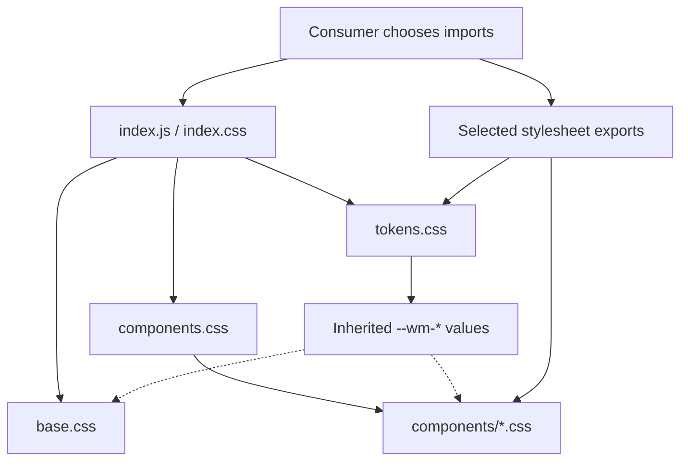

# Theme package architecture

`@wintermuted/ui-theme` owns the shared visual language: CSS tokens, document defaults, and component styles. It is framework-independent and has no React dependency, optional React peer, or JavaScript theme initialization.

For consumer imports, see the [package README](../README.md). For workspace relationships and publication, see the [monorepo architecture](../../../docs/architecture.md) and [release runbook](../../../docs/releases.md).

## Source layout

```text
ui-theme/
  index.js                 Bundler entry that imports index.css
  index.css                Complete theme stylesheet
  styles/
    tokens.css             Shared values and dark-theme overrides
    base.css               Document and native-element defaults
    components.css         Component stylesheet registration
    components/*.css       Individual component styles
  package.json             Public paths and package file selection
  docs/architecture.md     Repository-only implementation guide
```

There is no CSS compilation stage. Published CSS comes from these source files, and `index.js` has only a stylesheet import.



The arrows describe loading and value consumption, not generated build artifacts.

## CSS layers and ownership

### Tokens

`styles/tokens.css` defines the `--wm-*` namespace. It includes spacing, text/control dimensions, font stacks, semantic colors, shadows, radii, and popup/tooltip layers.

Light values are declared on `:root`. `[data-theme="dark"]` overrides the relevant tokens. CSS custom properties inherit, so components consume the resolved values rather than maintaining separate JavaScript color objects.

Token names express roles such as surface, accent, danger, and border. New component CSS should reuse those roles. Add a token only when a shared semantic value is needed; avoid introducing a parallel component-specific palette.

Consumers can override custom properties through the cascade. Override values after loading the theme, and consider both light and dark contexts. Scoped overrides can work through inheritance, but existing component selectors may also consult `[data-theme="dark"]`; nested themes and portals need explicit verification.

### Base styles

`styles/base.css` intentionally affects the document and native elements: box sizing, typography, page background, links, form controls, and headings.

The package being React-free does **not** mean the complete stylesheet is free of global CSS effects. A consumer that wants tokens and selected component styles without the document defaults can choose modular imports and omit `base.css`.

The font token defines a stack; loading CSS does not download fonts. Applications own any web-font assets and font-loading policy.

### Component styles

`styles/components/*.css` owns component presentation, including variants and interaction states. Prefer the scoped `.wm-*` classes for new integrations. Some styles retain unprefixed compatibility selectors such as `.btn`; do not remove existing selector aliases as incidental cleanup.

React components use these same classes. They do not own a second stylesheet implementation, and many CSS components can be used directly in ordinary HTML.

CSS covers appearance, focus treatment, disabled states, and layout. It does not implement stateful keyboard interaction or dialog focus management; those belong to the integrating application or React package.

## Import contract

Consumers choose a complete or modular entry:

```js
import "@wintermuted/ui-theme";
```

```js
import "@wintermuted/ui-theme/styles/tokens.css";
import "@wintermuted/ui-theme/styles/components/button.css";
```

The complete entry imports tokens, base styles, and the component aggregate in that order. A modular consumer must load the tokens needed by its selected component styles and provide any document defaults it omitted.

`package.json` is the authoritative public-path list. A file on disk is not necessarily importable through the package: it must also appear in `exports`. The `files` list determines what reaches the npm tarball.

The removed `react`, `react/select`, and `theme` paths are not aliases in 1.0. Runtime helpers and React components belong to `ui-react`; see the [migration guide](../../../docs/migration-to-v1.md).

## Adding or changing a component

1. Add or update the owning stylesheet under `styles/components`.
2. Reuse `--wm-*` values and keep selectors scoped; preserve existing aliases and public class behavior unless the change is explicitly breaking.
3. Register a new stylesheet in `styles/components.css` and export its path from `package.json`.
4. Add or update the showcase page and its navigation alongside the component.
5. If React exposes the component, keep its class names and documented variants aligned in `ui-react`, without adding a dependency from this package back to React.

Exercise dark/light appearance, focus, disabled state, content growth, and narrow layouts. Keep accessible semantics and reduced-motion behavior intact where the component defines them.

The existing CSS is the visual authority. A targeted component change is not permission to replace typography, base styling, or unrelated controls.

## Runtime theme selection

The CSS responds to theme attributes; it does not choose or persist a preference. A non-React application can set the document attribute itself:

```html
<html lang="en" data-theme="dark">
```

React consumers use helpers from `@wintermuted/ui-react/theme` and a document-level `ThemeProvider`. OS preference tracking, local storage, and SSR first-paint scripts live there, not in this package.

## Packaging and dependency boundary

The theme ships source CSS and its CSS-loading root, README, and license. It has no prepack React-copy step and no Nx dependency on `ui-react`.

The relationship is one-way:

```text
ui-react -> ui-theme
```

Changing styling may affect React rendering because both share the CSS contract. That is a consumer relationship, not a reason to make React a theme dependency.

Package architecture documentation is maintained in the repository; the current package `files` list does not include `docs`. Published README links therefore point to the GitHub-hosted guide.

## Validation and release impact

`tests/package.test.js` checks public files, component registration, the CSS-only root, removed React paths, dependency direction, and local linking without React preparation. `tests/consumers.mjs` installs a real packed theme without suppressing optional dependencies and checks that React packages and compatibility files were not installed.

Browser checks cover native interactions and showcase behavior. CSS lint and application build checks remain in CI.

Removing an export, token, selector, or styling contract can break non-React consumers as well as React applications. Document the migration and preserve a breaking conventional-commit marker when necessary; let Nx Release manage versions and tags.
